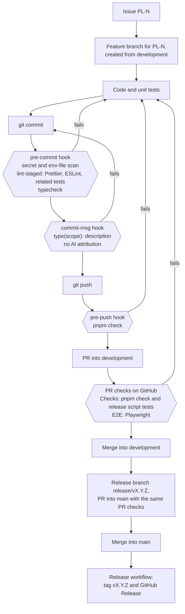

# paliturka

paliturka is a personal cloud hub for EPUB books: you upload your books once, so the files no longer sit in different folders on your computers, and then read and annotate them from any device. It is a learning project for personal use, with no monetization planned.

## Status

In development. Stage 1 (Skeleton) is done: the Next.js app, the database and file storage setup, languages and themes, linters, tests, PR checks and git hooks. The product features (sign-in, the library, the reader, annotations) are not built yet, and the app shows a placeholder home page. The next stage is sign-in.

## Stack

Next.js with TypeScript, SQLite through Prisma, Tailwind CSS and shadcn/ui, next-intl (English and Ukrainian), Vitest for unit tests and Playwright for end-to-end tests. Everything runs locally: there are no servers or external accounts yet.

## Requirements

- **Node.js 26.** The exact version is in `.nvmrc`; `nvm use` switches to it. `pnpm install` fails on a version outside `>=26 <27`.
- **pnpm 12.** The exact version is in `packageManager` in `package.json`; install it with `npm install -g pnpm@12.18.0`. An older pnpm fails with `packages field missing or empty`.
- **Python 3**, only for the release script tests.

## Quick start

```bash
pnpm install
cp .env.example .env.local
pnpm dev
```

Then open `http://localhost:3000`. The app, `pnpm build` and the e2e tests do not start without `.env.local`; the values in `.env.example` work as they are.

`pnpm install` also generates the Prisma client and sets up the git hooks.

## Development flow

How a change goes from an issue to a release, and where each check runs:



- The hooks run on your computer; `pnpm install` sets them up.
- `pnpm check` is the one list of checks: the pre-push hook and the `Checks` job on GitHub run the same command.
- A PR can be merged only when both `Checks` and `E2E` pass.
- The diagram follows `.husky/` and `.github/workflows/`; update it when they change.

## Checks

```bash
pnpm check         # all of the below plus the unit tests with the coverage threshold; stops at the first failure
pnpm lint          # ESLint, fails on warnings too
pnpm format:check  # Prettier, check only
pnpm format        # Prettier, format all files
pnpm lint:fsd      # Steiger: Feature-Sliced Design rules in src/
pnpm typecheck     # TypeScript, no output files
```

The `PR checks` workflow runs `pnpm check`, the release script tests and the e2e tests on every PR into `development` and `main`.

## Tests

Unit tests (Vitest):

```bash
pnpm test           # run once
pnpm test:watch     # rerun on file changes
pnpm test:coverage  # run once with a coverage report; fails below 80%
pnpm test:ui        # Vitest UI in the browser
pnpm test:changed   # run once, only the tests related to uncommitted changes
```

The Vitest UI asks for a token. The first time in a browser, copy the full `UI started at …?token=…` URL from the terminal into the address bar; the browser then keeps a login cookie.

End-to-end tests (Playwright, in Chromium, Firefox and WebKit). Install the browsers once after cloning and after updating Playwright. The tests start `pnpm dev` themselves, or reuse one already running at `http://localhost:3000`:

```bash
pnpm exec playwright install chromium firefox webkit
pnpm test:e2e         # run once
pnpm test:e2e:ci      # run against the production build, as on CI; stop pnpm dev first
pnpm test:e2e:ui      # Playwright UI mode
pnpm test:e2e:headed  # run with visible browser windows
pnpm test:e2e:report  # open the HTML report of the last run
```

Release script tests:

```bash
python -m unittest discover -s scripts/release/tests   # Windows
python3 -m unittest discover -s scripts/release/tests  # macOS and Linux
```

## Other commands

```bash
pnpm build        # production build
pnpm start        # start the production build
pnpm db:generate  # generate the Prisma client after a schema change
pnpm db:migrate   # create and apply migrations in development
pnpm db:studio    # open Prisma Studio
```

`postinstall` (Prisma client) and `prepare` (git hooks) run on their own during `pnpm install`.

### Testing on a phone or tablet

Put the computer's local IP (`pnpm dev` prints it as `Network`) into `DEV_ALLOWED_ORIGINS` in `.env.local`, for example `DEV_ALLOWED_ORIGINS=192.168.1.20`, restart `pnpm dev` and open `http://<ip>:3000/uk` on the device on the same network. Without it, Next.js blocks the dev assets for that address and parts of the page stay blank. Never commit the IP.

## Git hooks

`pnpm install` sets up three hooks (husky). A failing hook stops the commit or the push: fix the problem and run it again. Never skip them with `--no-verify`.

- **pre-commit:** blocks staged local environment and key files (`.env`, `.env.*` except `.env.example`, `.env.sample` and `.env.template`, `*.pem`, `*.key`, `id_rsa*`) and added lines that look like secrets; then runs Prettier, ESLint with `--fix` and the related unit tests on the staged files, and `pnpm typecheck` for the whole project. The fixes are added to the commit.
- **commit-msg:** checks the commit message format (see Commits) and blocks AI attribution such as `Co-Authored-By` trailers.
- **pre-push:** runs `pnpm check`.

A line that only looks like a secret, such as a fake value in a test, passes the scan with a `secret-scan: allow` comment on it.

## Commits

```text
type(scope): description

What changed and why.

Part of PL-N.
```

- Types: `feat`, `fix`, `docs`, `refactor`, `perf`, `test`, `build`, `ci`, `style`, `chore`.
- Scope: `frontend`, `backend`, `tooling`, or none.
- Subject: imperative, lowercase, no trailing period, at most 72 characters; body lines at most 72.
- `Part of PL-N.` is the last line when the branch has an issue key.

The full rules are in the Commits section of [CLAUDE.md](CLAUDE.md#commits).

## Editor

In VS Code, install the recommended extensions it offers when the project opens: Tailwind CSS IntelliSense, ESLint and Prettier. The shared settings format with Prettier on save and run ESLint with the project config.

## More

[CLAUDE.md](CLAUDE.md) holds the product rules, the conventions and the Git workflow.
